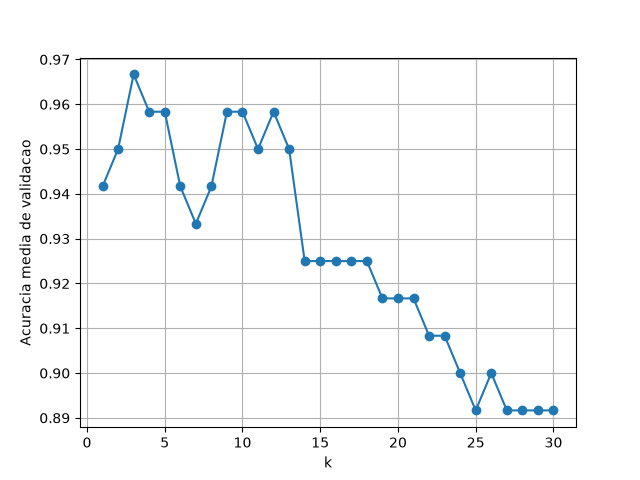

## Algoritmo k-nn e Titanic
Atividade proposta na disciplina de Inteligência Artificial, com a proposta de criar um classificador para possíveis sobreviventes da tragédia do Titanic com aprendizado de máquina supervisionado com 82% de acurácia.

# Visualização

### Regra do Cotovelo
